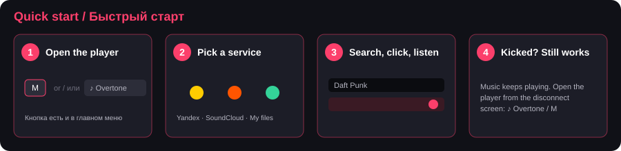
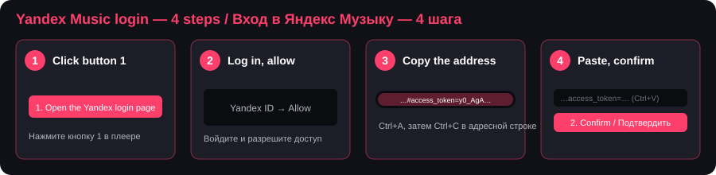
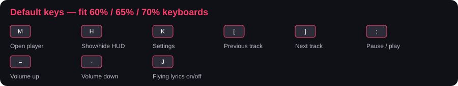

# Overtone (Fabric и NeoForge, Minecraft 1.21.1 – 26.3)

Авторы: **chifir4ik**, **PabJlo**. Язык мода выбирается по языку Minecraft: русский, английский, японский.

Музыка в игре: Яндекс Музыка, SoundCloud, Spotify и свои файлы, караоке, летающий текст в мире, настраиваемый HUD и статус в Discord.

## Быстрый старт

1. **Установите** Fabric Loader + Fabric API (или NeoForge) и положите подходящий по версии игры jar в папку `mods`.
2. **Откройте плеер**: клавиша `M` в игре, либо кнопка **«♪ Overtone»** в левом верхнем углу главного меню, меню паузы и экрана «Вас отключили». Плеер работает и без мира: если вас кикнуло, музыку можно остановить или переключить прямо там.
3. **Выберите площадку.** SoundCloud и «Мои файлы» работают сразу, без входа. Для Яндекс Музыки нужен вход (ниже).
4. Введите название трека, нажмите Enter, кликните по треку. Закрытие окна музыку не останавливает.

При первом открытии плеера инструкция показывается сама; позже её можно открыть кнопкой **«?»** в шапке плеера или в настройках («Общие» → «Открыть инструкцию»).

## Артисты, альбомы и плейлисты (Яндекс Музыка)

Под полем поиска есть вкладки **Треки / Артисты / Альбомы / Плейлисты**: один запрос ищет сразу по всем.

- Клик по **артисту** открывает его страницу: вкладки «Популярное» и «Альбомы».
- Клик по **альбому** или **плейлисту** открывает список треков; кнопка **«▶ Играть всё»** запускает его с первого трека, обычные очередь, шафл и повтор работают поверх.
- **«‹ Назад»** возвращает на шаг назад. Во вкладке «Плейлисты» первой строкой стоит **«Мои плейлисты»**.
- В плеере клик по **имени артиста** или **названию альбома** под обложкой открывает его страницу прямо с играющего трека. Пример: ищем «The Retuses», открываем артиста, вкладка «Альбомы», OMYT, «Играть всё».

Это неофициальный API Яндекса: если сервис поменяет формат ответов, часть страниц может временно не открываться.

## Вход в Яндекс Музыку: по шагам

1. В плеере выберите **Яндекс Музыка** и нажмите кнопку **«1. Открыть страницу входа Яндекса»**. Откроется браузер.
2. Войдите в аккаунт Яндекса и **разрешите доступ**. После этого страница может выглядеть пустой или показать ошибку: так и должно быть, токен уже лежит в адресе.
3. Кликните по адресной строке браузера, нажмите `Ctrl+A`, затем `Ctrl+C`. Искать токен вручную не нужно: мод сам вытащит его из ссылки.
4. Вернитесь в Minecraft, кликните по полю, нажмите `Ctrl+V`, затем кнопку **«2. Подтвердить»**.

В следующий раз вводить ничего не нужно: на экране входа появится список сохранённых аккаунтов, достаточно кликнуть по своему.

**Что-то не получилось?**

| Проблема | Что делать |
|---|---|
| «Вход не удался» | Скопируйте адрес заново сразу после разрешения доступа: в нём должно быть `access_token=`. Иначе откройте страницу входа ещё раз. |
| Нет звука | Громкость в плеере и устройство вывода в системе. Если включено «Учитывать громкость игры» (по умолчанию выключено), проверьте ещё ползунки «Основная» и «Музыка» в настройках звука Minecraft: при нуле на любом из них плеер молчит. |
| Музыка играет не в наушники, а в колонки | Откройте настройки → «Общие» → «Устройство вывода» и выберите нужное. «Авто» — то же устройство, что выбрано в настройках звука Minecraft (OpenAL); в списке показываются системные аудиоустройства. |
| «Нет соединения с …», `Remote host terminated the handshake`, `HTTP connect timed out` | Сайт недоступен из вашей сети (чаще всего SoundCloud или сервисы текстов у провайдера). Мод пробует три способа подключения (обычный, TLS 1.2 по HTTP/1.1, без системного прокси); если не помогло, включите VPN. При ошибке `UnresolvedAddress`/`ConnectException` с VPN проверьте, что в нём не задан неработающий прокси. |
| Краш `Modules musicplayer and citadel export package …jaad…` | Исправлено: AAC-декодер лежит в пакете `dev.musicplayer.libs.jaad`, а не в `net.sourceforge.jaad`, поэтому с Citadel и другими модами с JAAD не пересекается. |
| На Android (Zalith, PojavLauncher) «нет подходящего аудиовыхода» | В Java на Android нет вывода звука Java Sound, поэтому плеер там играть не может. Это ограничение платформы, а не ошибка мода. |
| «Не удалось воспроизвести» / «Ошибка звука» | Раньше возникало, когда другой мод подсовывал свою версию библиотеки MP3 (jlayer). Декодер встроен в мод и конфликтовать с другими модами не может; обновите мод. Если ошибка осталась, пришлите `logs/latest.log`. |
| Кикнуло с сервера | Музыка продолжает играть. Откройте плеер кнопкой «♪ Overtone» на экране отключения или клавишей `M`. |
| Текст песни опаздывает | Настройки → «Текст песни» → «Сдвиг текста». |
| Окно плеера слишком большое или маленькое | Настройки → «Плеер» → «Размер окна». На маленьких экранах или при большом масштабе интерфейса Minecraft окно ограничивается автоматически. |

## Клавиши по умолчанию

Клавиша «Скрыть HUD» по умолчанию не назначена: привяжите её сами в «Управление» → Overtone. Опция «Прятать по Tab» (по умолчанию выключена) плавно гасит виджет, текст и громкость, пока зажат список игроков. Все клавиши есть на компактных клавиатурах (60–75%): никаких цифрового блока, F-ряда и стрелок. В ванильном меню «Управление» они собраны в отдельной категории **Overtone**. Работают в игре, в окне плеера и на экранах главного меню, паузы и отключения. Меняются в настройках → «Клавиши» (правый клик по клавише возвращает значение по умолчанию) или в ванильном меню. При обновлении со старой версии клавиши один раз сбрасываются на новые.

## Настройки

Кнопка «Настройки» в плеере, клавиша `K` или «Мод → Настройки».

- Левый клик по настройке: далее / переключить. **Правый клик: назад**, а у ползунка **сброс к значению по умолчанию** (его положение отмечено белой риской).
- Числа (отступы, сдвиг текста в мс, расстояние и т.д.) настраиваются ползунками.
- Внизу окна подсказка к настройке, на которую наведён курсор.
- Значения по умолчанию подобраны так, чтобы можно было сразу играть: виджет показывается на 15 секунд при старте и в конце песни, дистанция летающего текста 14 блоков, громкость плеера независима от ползунков звука Minecraft (учёт «Основная» × «Музыка» включается в «Общие» → «Учитывать громкость игры»).

## Spotify и визуализатор

- **Spotify** — четвёртая площадка. Вход через свой Client ID с developer.spotify.com (Redirect URI `http://127.0.0.1:43821/callback`), управление приложением Spotify; нужен Premium. Поиск по трекам и плейлистам, «Мои плейлисты».
- **Визуализатор** (вкладка «Визуализатор» в настройках, блок перетаскивается в HUD-редакторе): стили Bars/Blocks/Mirror/Wave, стерео, направление, цвета, пики, чувствительность и автоподстройка, сглаживание. Источник — звук мода или системный звук (для Spotify). Мини-эквалайзер на карточке тоже реагирует на реальный звук.
- **Летающий текст в мире**: анимации появления слов (Fly, Rise, Drop, Pop, Wave, Type, Spin, Glitch), по словам или по буквам, анимации ухода (падение на блоки с отскоком, рассыпание, улёт, ветер, сжатие, проваливание), время «жизни», скорость, цвета (классика, акцент, градиент, радуга, белый) и свечение.

## Площадки
Окно плеера (`M`) открывается на выборе площадки. Текущая видна в шапке (значок с названием) — клик по ней
возвращает к выбору, музыка при этом не прерывается. Все виджеты, караоке и текст в мире работают одинаково на любой
площадке: они читают состояние плеера, а не конкретный сервис.

| Площадка | Состояние |
|---|---|
| Яндекс Музыка | вход по токену, поиск, «Любимые», «Моя волна» и станции волны (жанры, настроения, занятия, эпохи), лайки |
| Мои файлы | mp3, flac, ogg (Vorbis), m4a (AAC) и wav/aiff/au с компьютера, без аккаунта и без сети |
| SoundCloud | поиск и прослушивание без входа; аккаунт привязывается ссылкой на профиль (лайки видны) или токеном (лайки можно ставить) |

Добавить площадку — значит написать один класс `MusicProvider` и зарегистрировать его в `PlayerController`;
экран выбора, HUD и тексты подхватят её сами. Очередь может быть смешанной: трек играет через ту площадку, которой принадлежит.

## Мои файлы
Перетащите папку или файлы прямо в окно плеера (с любой площадки) — они добавятся в библиотеку и запомнятся.
Ещё можно положить музыку в папку `overtone-music` рядом с игрой: мод создаёт её сам, кнопка «Папка» открывает её, а новые файлы подхватываются при каждом запуске и по кнопке «Обновить» (если скан уже идёт, следующий стартует сразу за ним).
- Убрать трек из библиотеки: наведите курсор на строку и нажмите `Delete`. Файл на диске не удаляется; вернуть его можно, снова перетащив в окно плеера.
- Теги (ID3 у mp3, Vorbis-комментарии у flac и ogg, iTunes-теги у m4a: название, исполнитель, альбом, вшитая обложка) читаются сами; если тегов нет, название берётся из имени файла
  («Исполнитель - Название.mp3»). Обложка `cover.jpg` / `folder.jpg` в папке альбома тоже подхватывается.
- Индексация идёт в фоне, результат хранится в `config/musicplayer-local/` и пересчитывается только для изменившихся файлов.
- Тексты: файл `.lrc` или `.txt` рядом с треком (UTF-8 или windows-1251); имя сравнивается без учёта регистра, номера трека и «Исполнитель - » в начале, так что `Song.LRC` подойдёт к `01. Band - Song.mp3`, затем текст из тегов, затем интернет (AMLL TTML DB, LRCLIB, KuGou, если включён).
  Расширенный LRC с тегами `<мм:сс.хх>` даёт пословную подсветку в караоке и летающем тексте.
- FLAC декодируется встроенным декодером, OGG Vorbis — через stb_vorbis, который уже есть в игре, m4a — встроенным AAC-декодером.
  Не поддерживаются Opus, ALAC внутри m4a и «голые» .aac: такие файлы при индексации пропускаются.

## SoundCloud
Без входа работают поиск и прослушивание. Кнопка «Войти в аккаунт» принимает одно из двух:
- **ссылку на профиль** (`soundcloud.com/ваше-имя`) — появятся ваши лайки, ничего секретного не нужно;
- **oauth_token** (F12 → Application → Cookies → soundcloud.com) — дополнительно можно ставить лайки с сердечка.

У части треков прогрессивный поток отдаёт 404, поэтому мод перебирает варианты: mp3, HLS mp3, HLS AAC.
Треки Go+ без подписки на аккаунте играют 30-секундным превью.

## Безопасность и приватность
- Нет телеметрии, аналитики и обращений «домой». Мод делает запросы только к выбранной вами площадке.
- Все запросы с токенами идут через проверяющий клиент с белым списком доменов (включая редиректы); токены не отправляются на CDN.
- Токен площадки отправляется только на её серверы (Яндекс — `api.music.yandex.net`, `oauth.yandex.ru`; SoundCloud — `soundcloud.com`, `sndcdn.com`)
  и хранится в `config/musicplayer.json`. На Linux и macOS файл доступен только владельцу. Не показывайте его другим.
- Локальные файлы не копируются и не загружаются: хранятся пути и прочитанные теги.
- Статус в Discord передаётся только запущенному на этом компьютере Discord (название, исполнитель, альбом, длительность и обложка, если она из интернета). Выключается в настройках.
- Сторонние сервисы для текстов (всё выключается одним переключателем «Тексты из интернета» в настройках → «Общие»):
  - **LRCLIB** (`lrclib.net`): уходят название, исполнитель, альбом и длительность трека.
  - **AMLL TTML DB** (`raw.githubusercontent.com`): пословные тексты для караоке. Раз в 3 дня с GitHub скачивается общий список песен (около 2 МБ, лежит в `config/musicplayer-cache`), поиск идёт у вас локально, на GitHub уходит только запрос файла с найденным текстом. Переключатель «Пословные тексты (AMLL)».
  - **KuGou** (`kugou.com`): неофициальный API китайского сервиса, на его серверы уходят название, исполнитель и длительность. **По умолчанию выключен**, переключатель «Тексты KuGou».
  Если всё выключено, используются только тексты площадки и файлы `.lrc`.
- Исходный код открыт (MIT), сторонние компоненты перечислены в `THIRD_PARTY_NOTICES.txt`.

## Тексты песен
Все источники опрашиваются одновременно, у каждого свой таймаут: если один недоступен (блокировки, VPN), остальные продолжают искать.
Приоритет: тексты самой площадки (для Яндекса — тексты Яндекс Музыки, для локальных файлов — `.lrc` рядом с треком), затем AMLL TTML DB, LRCLIB и KuGou.
Если текст не нашёлся, мод повторяет поиск ещё три раза (через 6 с, 20 с и минуту): чаще всего виноват временный сбой сети.
Найденное в интернете проверяется на совпадение названия, исполнителя, длительности и алфавита: лучше пустой текст,
чем текст другой песни или английский вариант к русскому треку. Если название совпало, а исполнитель нет (на SoundCloud
вместо исполнителя часто имя канала), текст берётся только при расхождении длительности не более 3 секунд.
Если у найденной песни тайминги не подходят, показывается её обычный текст без подсветки.
Не нашлось ничего — в логе игры появится строка `No lyrics found`.

## Окно плеера
Цвет окна берётся из акцента HUD-виджета (настройки → «Плеер» → «Цвет как у виджета»). Помимо семи готовых цветов есть серый кружок: он открывает палитру со своим цветом, hex вводится вручную: малиновый виджет
даёт малиновый плеер — название, ползунки, кнопка play, подсветка текущей строки. Крупная обложка трека,
нарисованные кнопки, перемотка перетаскиванием. При крупном масштабе интерфейса игры окно не сжимается: масштаб на время его открытия уменьшается ровно настолько, чтобы окно поместилось, и затем возвращается. Настраиваются цвет, подсветка и затемнение фона,
скругление, размер окна (в процентах) и обложки, текст песни.

## Летающий текст в мире
Настройки → «В мире» (или клавиша `J`, переназначается): слова песни летят прямо в игровом мире. Каждое слово
прилетает из глубины в момент, когда его поют, звучащее слово подсвечено акцентом; через пару секунд строка
всплывает и растворяется, новые строки вытесняют старые вверх. Режимы: «Рядом с игроком» (текст плавно держится
перед тобой, пока бежишь; у стены он не сжимается к камере, а уходит за блоки, если «Виден сквозь блоки» выключено) и «На месте строки» (остаётся там, где появился, ты пробегаешь мимо). Настраиваются
размер, дистанция, высота, «Зона слов (угол)» (насколько широко от центра экрана появляются слова: для узкого или растянутого экрана её стоит уменьшить), «сквозь блоков», тень; кнопка «Показать пример перед собой» — проверить вид.
Тайминги слов берутся из тегов `<мм:сс.хх>` в тексте (расширенный LRC), а если их нет — длительность строки делится
между словами по длине. Пока летающий текст работает, обычный HUD-текст и текст в «Карточке» для этого трека скрыты;
у треков без таймкодов всё отображается как раньше.

## Статус в Discord
Если запущен Discord, в статусе видно, что ты слушаешь через Overtone: трек, исполнитель, обложка и полоска времени.
Мод общается только с приложением Discord на этом компьютере через его локальный канал. Выключается в настройках → «Общие» → «Статус в Discord».

## Громкость
Громкость плеера задаётся только его собственным ползунком (клавишами или в окне плеера) и **не зависит** от ползунков звука Minecraft: музыка игры и музыка плеера регулируются отдельно.
Если хотите, чтобы плеер подчинялся ванильным настройкам, включите «Общие» → «Учитывать громкость игры»: тогда громкость = ползунок плеера × «Основная» × «Музыка».
При обновлении со старых версий это значение один раз сбрасывается в «выкл».

## Громкость на экране
При смене громкости клавишами в мире появляется плашка (как в Windows) и гаснет через пару секунд.
Настройки → «Громкость»: вид (полоса / компактный / вертикальный), позиция, масштаб, фон, время показа, проценты.

## Аккаунты
Токен остаётся в `config/musicplayer.json` и после «Выйти»: на экране входа список аккаунтов — выбираешь, и ты
внутри, без повторной вставки ссылки. «x» рядом с аккаунтом забывает его и удаляет токен. «+ Добавить другой
аккаунт» открывает обычную форму входа по токену.

## Очередь, повтор, лайки
Слева кнопка «Очередь N»: у каждого трека в списке `+` (в очередь) и `>` (играть следующим); в очереди `^` (выше) и `x` (убрать).
Очередь пользователя играет раньше списка поиска и сохраняется между запусками. Под ползунком времени —
«Случайно» и «Повтор: выкл/все/один». Сердечко справа от названия ставит и снимает лайк. «Выйти» — смена аккаунта.
Сдвиг текста (если опаздывает) — настройки → «Текст песни» → «Сдвиг текста»; тег `[offset:]` в LRC учитывается.
Обложки кэшируются на диск: `config/musicplayer-cache/`.

## Сохранение между запусками
`config/musicplayer-player.json` — вид плеера и клавиши, `config/musicplayer-session.json` — громкость,
последний поиск, список треков и последний трек (после запуска игры он выбран, но не играет — жмёшь play).

## HUD
Два независимых элемента, у каждого свои позиция, масштаб и фон:

**Виджет «Сейчас играет»** — 6 стилей: Карточка, Классика, С прогресс-баром, Компактный,
Над хотбаром, Как подсказка. Обложка альбома, время, эквалайзер, 7 цветов акцента и свой цвет (серый кружок → палитра),
режим показа (всегда / 15 с / 5 с при старте и в конце трека).

**Текст песни** — «Субтитры» (текущая + следующая строка) или «Караоке» (3–9 строк с плавной
прокруткой). Работает с синхронизированными текстами; в Карточке текст можно показать внутри.

Позиция: можно **перетащить мышью** — настройки → «Перетащить мышью…» (на вкладках «Виджет», «Текст песни»,
«Громкость») открывают редактор прямо поверх игры: тащишь виджет, текст и плашку громкости, колесо над
элементом меняет масштаб, стрелки двигают на 1 пиксель, у центра экрана элемент «прилипает». Якорь выбирается
сам. Вручную по-прежнему доступны 9 якорей (углы, центры сторон, центр) и отступы по X/Y с шагом 1 и 5 пикселей.
Стиль виджета «Над хотбаром» привязан к хотбару и мышью не двигается.
Настройки показываются вживую в предпросмотре (если ничего не играет — демо-данные).

Конфиги: `config/musicplayer-hud.json` (HUD), `config/musicplayer.json` (токены, открытым текстом, только для владельца), `config/musicplayer-local/` (индекс «Моих файлов»).

## Лицензия
MIT, © 2026 chifir4ik, PabJlo — см. `LICENSE`. Можно использовать и менять как угодно, но с сохранением нашего копирайта.

## Благодарности и лицензии
При разработке дизайна помог мод [SpotifyMusicMod](https://github.com/Kart-Modding/SpotifyMusicMod)
(Kart-Modding, лицензия MIT, © Kartonek); на нём же основан рендер-слой (Canvas, загрузка обложек).
Текст лицензии — в `LICENSE-SpotifyMusicMod.txt`, он же включён в jar.
Сторонние компоненты (SpotifyMusicMod — MIT, JLayer — LGPL, встроен в мод; JAAD — public domain) — в `THIRD_PARTY_NOTICES.txt`, текст LGPL — в `LICENSE-jlayer.txt`.

## Версии и сборка

| Файл | Игра |
|---|---|
| `overtone-0.2.1-mc<версия>-<загрузчик>.jar` | 1.21.1, 1.21.4, 1.21.5, 1.21.8, 1.21.10, 1.21.11, 26.1, 26.2, 26.3 |

Поддерживаются только перечисленные версии, на промежуточных (1.21.2, 1.21.3, 1.21.6, 1.21.7, 1.21.9) мод не проверялся.

Сборка всех версий: `./gradlew buildAll --continue` (или `build-all.sh` / `build-all.bat`). Готовые jar-файлы окажутся в `dist/`.
Одна версия: `./gradlew :fabric-1.21.4:build`, `./gradlew :neoforge-26.2:build`.
Нужен интернет (Gradle сам докачает JDK 21 и 25) и около 3 ГБ свободной памяти.

### Устройство проекта

- `src/common` — весь код мода; от версии игры не зависит.
- `src/compat/<поколение>` — тонкий слой над тем, что менялось между версиями: отрисовка (`CanvasImpl`), база экранов (`ModScreen`), ввод (`KeyInput`, `Keys`), текстуры, текст в мире.
- `src/game/{mc,gui}` — где лежит текущий экран (`mc.screen` до 26.1, `mc.gui.screen()` с 26.2).
- `src/fabric/<поколение>`, `src/neoforge/<поколение>` — точка входа и подписки на события загрузчика.
- `targets.json` — список целей (версия игры, поколение, версии зависимостей). Новая версия — новая запись и, если API изменился, новое поколение.
- Версию мода меняйте в `gradle.properties` (`mod_version`).

Для Minecraft 1.20.1 (Fabric и Forge/NeoForge) есть отдельный проект `overtone-1.20.1` с тем же кодом.
